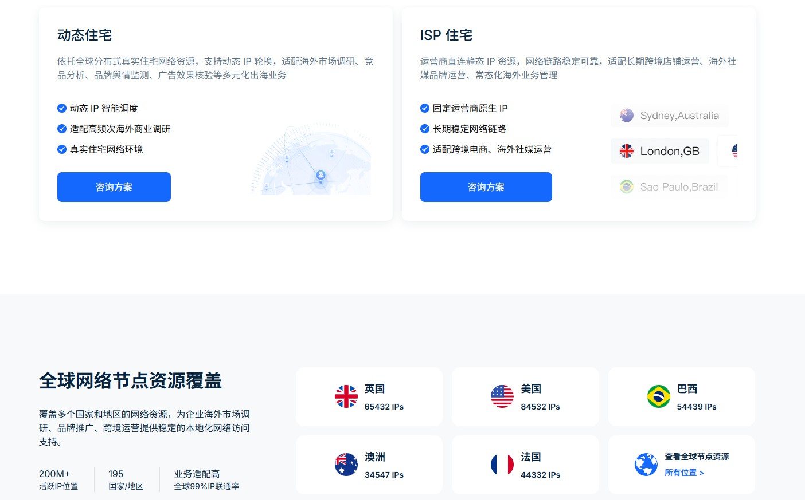

# 美国住宅IP购买平台推荐2026：纯净美国住宅独享IP · 家庭宽带IP · 美国静态IP价格与免费试用指南

> **一站式跨境网络基础设施 —— 覆盖 190+ 国家和地区，支持 HTTP(s)/SOCKS5 协议，99.9% 网络连通率，7×24 小时技术支持。**



---

## 🚀 立即开始

> ### 👉 [**免费领取代理套餐 →**](https://huge.985proxy.com/?2MYGOZ)
>
> **新用户专享 · 即开即用 · 无需绑定信用卡**
>
> 👉 [**立即注册，获取专属优惠 →**](https://huge.985proxy.com/?2MYGOZ)

---

## 目录

1. [概述](#一概述)
2. [核心能力与平台数据](#二核心能力与平台数据)
3. [产品体系：两大住宅代理方案](#三产品体系两大住宅代理方案)
4. [全球网络节点资源覆盖](#四全球网络节点资源覆盖)
5. [企业海外网络接入的六大应用场景](#五企业海外网络接入的六大应用场景)
6. [多语言 SDK 与 API 集成](#六多语言-sdk-与-api-集成)
7. [TikTok 全场景网络解决方案](#七tiktok-全场景网络解决方案)
8. [用户真实评价](#八用户真实评价)
9. [常见问题解答](#九常见问题解答)
10. [企业专属服务与合作方式](#十企业专属服务与合作方式)
11. [美国住宅 IP 购买完全指南](#十一美国住宅-ip-购买完全指南)
12. [结语](#十二结语)

### 🔍 本文覆盖的搜索词

> 美国住宅ip购买平台 · 美国住宅独享ip · 纯净美国住宅ip购买 · 美国家庭宽带住宅ip · ip购买 · 美国住宅ip购买网站 · 美国静态ip购买指南 · 美国住宅ip免费 · 美国静态住宅价格 · 美国家用宽带ip

---

## 一、概述

在全球化经营成为常态的今天，跨境电商、多账号运营、海外市场调研、社交媒体运营等业务，都对**稳定、合规、高质量的海外网络接入**提出了刚性需求。

985 Proxy 定位为**全球跨境企业海外业务网络服务提供商**，围绕"全球分布式节点 + 高稳定性独立网络地址"构建一站式跨境基础设施，帮助企业在海外业务全链路中获得可靠的网络环境支撑：

- **赋能跨境电商**：为多店铺、多账号运营提供独立、干净的网络身份；
- **支撑多账号运营**：通过 IP 隔离降低账号关联风险，提升存活率；
- **服务海外调研**：以本地化视角获取真实市场数据与搜索结果；
- **助力社媒运营**：为 TikTok、YouTube、Twitter 等平台提供原生网络环境。

平台汇集全球 **190+ 地区的合规住宅网络资源**，并以 **99.9% 的稳定运行率**作为服务承诺，让出海企业可以专注于业务本身，而不必为网络环境分心。

### 三大基础特性

| 特性 | 说明 |
| --- | --- |
| 🌍 覆盖范围广 | 覆盖 190 多个国家和地区的海外网络资源 |
| 🔒 环境隔离强 | 高度安全的业务环境隔离，杜绝账号关联 |
| 🔌 协议兼容全 | 支持 HTTP (s) / SOCKS5 标准网络协议 |

---

## 二、核心能力与平台数据

平台以透明的运营数据体现服务实力：

| 指标 | 数值 | 含义 |
| --- | --- | --- |
| 国家/城市覆盖 | **190+** | 全球主要市场均有本地化节点 |
| 并发会话 | **不限量** | 不限制同时建立的连接数量 |
| 网络连通率 | **99.9%** | 长期稳定在线，几乎无中断 |
| 技术支持 | **7×24** | 全天候人工技术响应 |
| 活跃 IP 位置 | **2 亿+** | 海量真实住宅 IP 池 |
| 覆盖国家数 | **195** | 全球 IP 连通率达 99% |

此外，平台还获得了行业高评分住宅代理排名与 **ISO 27001 信息安全管理体系认证**，在服务质量与信息安全管理两方面均达到国际标准。

---

## 三、产品体系：两大住宅代理方案

针对不同的业务周期与稳定性要求，平台提供两类核心产品。

### 1. 动态住宅代理（Dynamic Housing）

**定位**：高频、多变、需要真实住宅环境的业务场景。

依托全球分布式**真实住宅网络资源**，支持动态 IP 轮换，具体能力包括：

- ✅ **动态 IP 智能调度** —— 系统自动分配与轮换 IP，无需人工干预；
- ✅ **适用于高频海外业务调研** —— 应对大规模、高并发的数据请求；
- ✅ **真实住宅网络环境** —— IP 来自家庭宽带，与真实用户无异。

**典型适用场景**：海外市场调研、竞品分析、品牌舆情监测、广告效果验证等多元化海外业务。

### 2. ISP 静态住宅（ISP Residence）

**定位**：长期、稳定、需要固定网络身份的业务场景。

采用**运营商直连的静态 IP 资源**，网络链路稳定可靠，具体能力包括：

- ✅ **固定运营商原生 IP** —— IP 归属地与运营商信息真实可查；
- ✅ **长期稳定的网络链路** —— 数月保持同一 IP，不中断；
- ✅ **兼容电商与运营场景** —— 适配各类店铺与运营工具。

**典型适用场景**：跨境店铺长期运营、海外社媒品牌运营、常态化海外业务管理。

> 📖 想了解 **美国静态ip购买指南** 与 **美国静态住宅价格**？请查看 [第十一章](#十一美国住宅-ip-购买完全指南)。

### 产品对比一览

| 维度 | 动态住宅代理 | ISP 静态住宅 |
| --- | --- | --- |
| IP 类型 | 真实住宅动态 IP | 运营商静态原生 IP |
| IP 变化 | 智能轮换 | 固定不变 |
| 稳定性 | 高频调度、灵活 | 长期链路稳定 |
| 适配业务 | 调研、采集、广告验证 | 店铺运营、品牌运营 |
| 成本特点 | 按流量计费，灵活 | 长期持有，性价比高 |

---

### 💡 不确定选哪款？

> 👉 [**免费试用，顾问帮您选型 →**](https://huge.985proxy.com/?2MYGOZ)
>
> 根据您的业务场景，我们提供 **1 对 1 选型建议**与免费测试流量。

---

## 四、全球网络节点资源覆盖

平台覆盖多个国家和地区的网络资源，为企业海外市场调研、品牌推广、跨境运营提供**稳定的本地化网络接入支持**。

### 节点规模

- 🌐 **2 亿+** 活跃 IP 位置
- 🗺️ **195** 个国家
- 📈 业务高度适配，**全球 IP 连通率 99%**

### 主要国家/地区节点

| 国家/地区 | 可用 IP 数量 |
| --- | --- |
| 🇬🇧 英国 | 65,432 个 |
| 🇺🇸 美国 | 84,532 个 |
| 🇧🇷 巴西 | 54,439 个 |
| 🇦🇺 澳大利亚 | 34,547 个 |
| 🇫🇷 法国 | 44,332 个 |

> 其中**美国节点**是需求最旺盛的区域，提供大量 **美国家庭宽带住宅ip** 与 **美国家用宽带ip**，支持动态轮换与独享固定两种模式，详见 [美国住宅 IP 购买完全指南](#十一美国住宅-ip-购买完全指南)。

> 更多国家和地区可在平台"全球节点资源"页面查看完整列表，包括加拿大、德国、日本等主要出海市场。

---

## 五、企业海外网络接入的六大应用场景

依托全球网络资源，平台为以下业务场景提供稳定支撑。

### 🕷️ 1. 爬虫采集代理

使用**城市级优质代理**，可有效提升数据采集成功率。通过轮换 IP 与地域定位，避免目标网站的反爬机制，保证采集任务的连续性与完整性。

### ✈️ 2. 旅游抢票

支持**不限量的网络连接请求**，在抢票高峰期同时发起多路请求，显著提升成功抢票的概率，帮助用户在秒杀场景中占得先机。

### 🎯 3. 广告验证

测试广告投放效果、**优化 CPA**、验证素材真实性。广告主可以在不同国家和地区以本地用户视角查看广告实际展示情况，防止广告欺诈与无效投放。

### 💬 4. 社交媒体

提升产品在网络中的**活跃度与曝光**。为社媒账号提供独立、干净的网络环境，支持内容分发、互动运营与矩阵号管理。

### 🔍 5. 搜索引擎优化

搜索并采集**有价值的 SEO 数据**，助力竞争分析。以目标市场的本地搜索结果为依据，进行关键词研究、排名监控与竞品策略拆解。

### 📊 6. 市场调研

使用城市级优质代理采集一手市场数据，包括价格监测、用户画像、趋势分析等，为企业的出海决策提供可靠依据。

---

### 🎁 现在就用起来

> 👉 [**领取代理套餐，立即测试 →**](https://huge.985proxy.com/?2MYGOZ)
>
> 复制上方任意场景，**5 分钟完成接入**，立刻体验 190+ 国家的真实住宅 IP。

---

## 六、多语言 SDK 与 API 集成

平台兼容 **Python / Java / Node.js / PHP / C# / Ruby** 等主流编程语言，助力企业系统快速接入海外网络基础设施。

### 三大集成优势

1. **统一调度** —— 通过可视化管理平台统一调度网络资源；
2. **文档完善** —— 提供完整的开发者文档，支持第三方软件集成；
3. **权限灵活** —— 支持灵活的子账号创建与权限管理能力。

### 集成流程

```
注册账号 → 购买套餐 → 生成代理凭证 → SDK/API 接入 → 业务上线
```

开发者只需在请求中配置代理服务器地址、端口与认证信息，即可将业务流量切换至全球住宅网络。

---

## 七、TikTok 全场景网络解决方案

TikTok 是当前出海的热门阵地，平台围绕其运营全链路提供针对性的网络方案。

### 1. 多账号运营与真实性保障

使用家庭宽带（如中国电信、中国联通等）提供的**动态住宅 IP**，模拟真实用户网络环境。IP 地址定期更换，可规避平台风控限制，适用于批量注册账号、内容发布等场景，**显著降低封号风险**。成本低廉，适合个人创作者与中小团队。

### 2. 高性能直播与数据托管

通过数据中心提供的**高速固定 IP**，支撑直播、服务器托管等高带宽需求场景。具备强稳定性、低延迟，并配备 **DDoS 防护**等安全措施，适用于对网络质量要求较高的大型企业或直播业务。

### 3. 跨区域内容分发与市场调研

使用固定 IP 地址的**静态住宅 IP**（如海外 ISP 代理），避免频繁中断。精准定位目标市场（如欧美、东南亚），访问当地 TikTok 版本，分析热门内容、用户偏好与竞品策略，助力内容本地化。

### 4. 数据采集与批量操作

依托覆盖全球 **200+ 地区的动态 IP 池**，自动轮换 IP 地址，执行爬虫采集、批量点赞/评论等操作。避免单一 IP 触发流量限制，提升数据抓取效率，适用于市场趋势分析或营销自动化。

### 5. 低延迟全球直播

采用海外**独享原生 IP 专线**（如香港、美国节点），并通过 **SD-WAN 技术**优化跨境传输。解决直播卡顿、丢包问题，延迟可与国内直播媲美，保障跨境直播流畅稳定。

### 6. 账号安全与合规监管

结合**独享 IP 服务器与 IP 池清洗技术**，确保 IP 纯净度。严格匹配目标地区法律法规（如 **GDPR**），避免因共享 IP 导致的关联封禁，同时满足数据隐私保护要求。

### 方案速查表

| 业务诉求 | 推荐方案 | 核心价值 |
| --- | --- | --- |
| 批量账号注册 | 动态住宅 IP | 低成本、降封号风险 |
| 直播推流 | 数据中心固定 IP | 高带宽、低延迟、抗攻击 |
| 内容本地化调研 | ISP 静态住宅 IP | 固定身份、稳定访问 |
| 数据采集 | 动态 IP 池轮换 | 绕过限制、提升效率 |
| 跨境直播专线 | 独享原生 IP + SD-WAN | 不卡顿、不丢包 |
| 合规运营 | IP 清洗 + 独享服务器 | IP 纯净、规避关联 |

---

## 八、用户真实评价

> ⭐⭐⭐⭐⭐ **跨境电商运营者 · 李伟**
> "我们运营着 300 多个跨境店铺账号，切换到动态住宅池之后，账号存活率提升明显，连接也从未掉线。"

> ⭐⭐⭐⭐⭐ **增长营销负责人 · 陈晓**
> "城市级定位非常精准。我们的广告验证团队现在通过一次 API 集成，就能检查 40 多个市场的素材。"

> ⭐⭐⭐⭐⭐ **代理商创始人 · 王磊**
> "ISP 静态 IP 能连续数月保持纯净，非常适合长期运营的社媒品牌账号和店铺。"

> ⭐⭐⭐⭐⭐ **数据工程经理 · 张敏**
> "凌晨两点提工单，客服几分钟内就回复了。控制台让子账号和流量管理变得非常简单。"

---

## 九、常见问题解答

**Q1：支持哪些代理协议？**
所有套餐均支持 **HTTP、HTTPS 和 SOCKS5** 标准协议，可通过账号密码或 API 提取进行配置，可无缝对接各类浏览器、指纹浏览器、采集脚本与自动化工具。

**Q2：覆盖多少个国家和地区？**
平台在 **190 多个国家和地区**采集合规住宅网络资源，活跃 IP 数量超过 **2 亿**，覆盖欧美、东南亚、日韩、拉美等主流出海市场。

**Q3：并发会话有限制吗？**
**没有限制。** 并发会话数量不限，仅消耗您所购买套餐的流量，可放心执行高并发任务。

**Q4：是否支持企业定制？**
**支持。** 专属企业通道可提供定制化全球网络接入方案、子账号权限以及专属技术支持，满足大型企业的复杂业务需求。

**Q5：美国住宅 IP 怎么买？有哪些购买渠道？**
可以通过 **美国住宅ip购买平台** 直接在线下单。建议选择支持 **纯净美国住宅ip购买**、提供 **美国住宅独享ip** 的服务商，并优先确认是否拥有大量真实的 **美国家庭宽带住宅ip**。具体选购要点见 [第十一章 美国住宅 IP 购买完全指南](#十一美国住宅-ip-购买完全指南)。

**Q6：有免费的美国住宅 IP 吗？**
有。平台提供 **美国住宅ip免费** 测试额度，新用户可先领取免费套餐验证连通性与纯净度，满意后再进行正式的 **ip购买**。

**Q7：美国静态住宅价格大概是多少？**
**美国静态住宅价格** 因 IP 数量、带宽与是否独享而异，常见计费方式有按流量、按 IP/月、企业定制三种。对比报价时，建议同时关注纯净度与连通率，而不仅是单价。

---

## 十、企业专属服务与合作方式

### 重点客户专属企业通道

平台为**重点客户设立专属企业通道**，提供：

- 🎯 为企业定制的**全球网络接入解决方案**
- 👥 灵活的**子账号创建与权限管理**
- 📋 完善的**开发者文档**与第三方软件集成支持
- 🛠️ **7×24 小时**专属技术支持

### 合作与资源

- **联盟计划** —— 面向推广者的分成合作机制；
- **合作伙伴计划** —— 与渠道商、服务商共建生态；
- **帮助中心** —— 提供完整的产品使用文档与教程；
- **工具矩阵** —— Chrome 代理扩展、IP 查询、DNS 泄漏检测等实用工具。

### 页面底部说明

- 隐私政策 · 法律声明 · 退款协议
- 版权所有 © 2026 诚弘（福建）网络信息有限公司
- 闽ICP备2026036725号-2 ｜ 增值电信业务经营许可证 闽B1-20263914
- **公告：本平台服务不面向中国大陆地区提供，请您谅解。**

---

## 十一、美国住宅 IP 购买完全指南

如果你正在搜索 **美国住宅ip购买平台**、比较各家报价，或想弄清楚 **ip购买** 到底该怎么选，这一章会给你一份清晰的决策参考。

### 11.1 如何挑选美国住宅ip购买网站

选择一个靠谱的 **美国住宅ip购买网站**，建议重点考察以下五点：

| 考察维度 | 关键问题 |
| --- | --- |
| IP 池规模 | 是否拥有足够多的 **美国家庭宽带住宅ip**，能否支撑高频轮换 |
| 纯净度 | 是否为 **纯净美国住宅ip购买**，有无历史滥用记录 |
| 独享性 | 是否提供 **美国住宅独享ip**，避免与他人共享导致关联 |
| 协议兼容 | 是否支持 HTTP(s) / SOCKS5，接入是否顺滑 |
| 计费方式 | 是否支持按量付费、免费试用，价格是否透明 |

### 11.2 三类美国住宅 IP 的区别

- **动态美国家用宽带 IP** —— 来自真实家庭宽带，IP 定期轮换，适合批量注册、内容发布、广告验证等高频场景，也是目前 **美国住宅ip免费** 试用最常见的类型。
- **美国住宅独享 IP** —— 一人一 IP，不与其他用户共享，账号关联风险最低，适合长期养号、店铺运营。
- **美国静态 IP** —— 长期固定不变，链路稳定，是做 **美国静态ip购买指南** 类测评时的重点对比对象。

### 11.3 美国静态住宅价格怎么看

**美国静态住宅价格** 通常按 IP 数量与带宽计费，市场上常见区间为：

| 套餐类型 | 价格区间（参考） | 适合人群 |
| --- | --- | --- |
| 免费试用 | 0 元（**美国住宅ip免费** 额度） | 先测后买的个人用户 |
| 按量付费 | 按 GB 流量计费 | 爬虫采集、短期调研 |
| 包月静态 | 按 IP/月计费 | 店铺运营、长期养号 |
| 企业定制 | 一对一报价 | 大规模矩阵运营 |

> 💡 价格不是唯一标准。**纯净度 + 独享性 + 连通率** 往往比单价更重要，低价共享 IP 反而可能带来封号损失。

### 11.4 购买流程

1. 点击下方按钮进入 **美国住宅ip购买平台**
2. 选择套餐（支持 **美国住宅ip免费** 测试）
3. 生成代理凭证（账号密码 / API 提取）
4. 在浏览器或代码中配置，5 分钟完成接入

> 👉 [**进入美国住宅 IP 购买平台 →**](https://huge.985proxy.com/?2MYGOZ)
>
> 👉 [**免费领取测试套餐 →**](https://huge.985proxy.com/?2MYGOZ)

---

## 十二、结语

从**动态住宅代理**到 **ISP 静态住宅**，从 **190+ 国家的节点覆盖**到 **多语言 SDK/API 集成**，再到针对 **TikTok 全场景的专项网络方案**，985 Proxy 构建了一套完整的跨境网络基础设施。

对于正在布局全球市场的企业而言，选择一套稳定、合规、易集成的海外网络服务，不仅能降低账号风险、提升运营效率，更是业务规模化增长的底层保障。

---

## 🔥 最后一步

> ### 👉 [**立即获取套餐，开启全球业务 →**](https://huge.985proxy.com/?2MYGOZ)
>
> | 想要 | 入口 |
> | --- | --- |
> | 免费测试流量 | 👉 [**领取测试套餐 →**](https://huge.985proxy.com/?2MYGOZ) |
> | 查看价格与套餐 | 👉 [**进入定价页 →**](https://huge.985proxy.com/?2MYGOZ) |
> | 企业定制方案 | 👉 [**联系商务顾问 →**](https://huge.985proxy.com/?2MYGOZ) |
>
> ⏳ **限时优惠进行中**，名额有限，先到先得。

---

*本文档由 985 Proxy 官方页面内容整理生成，用于产品介绍与方案参考。*
